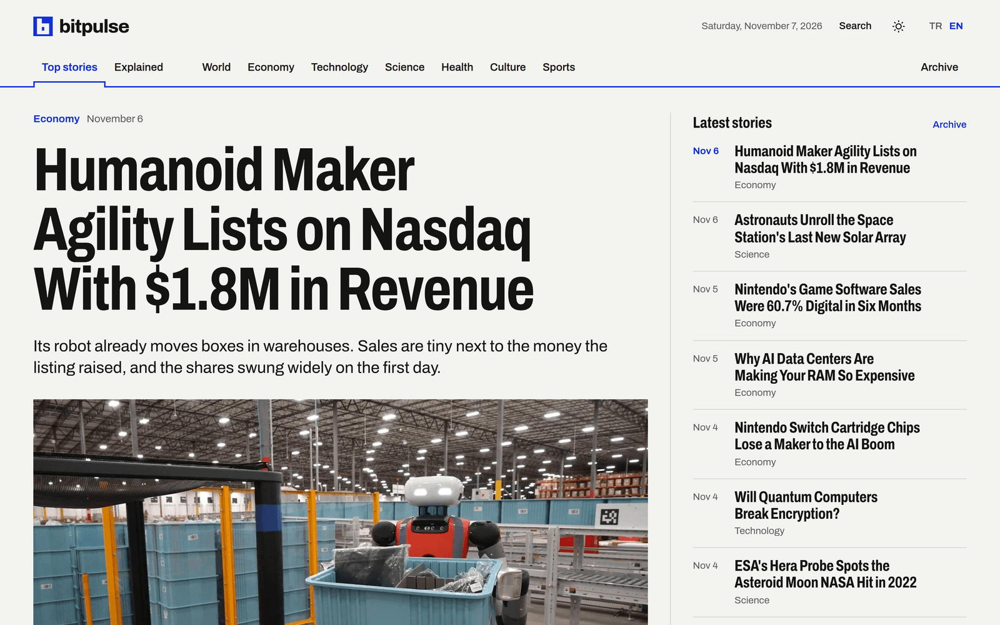
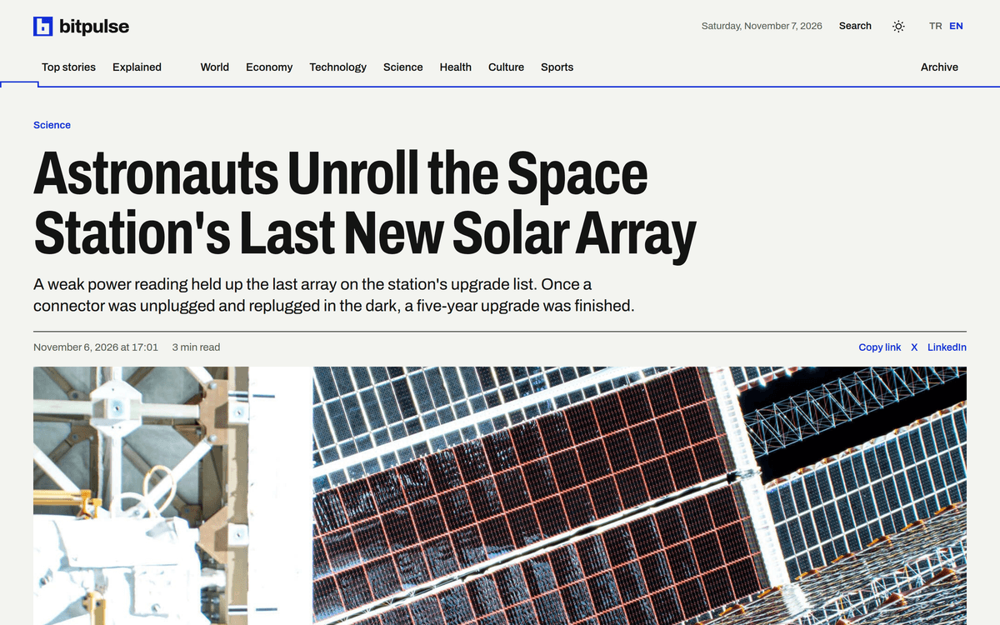
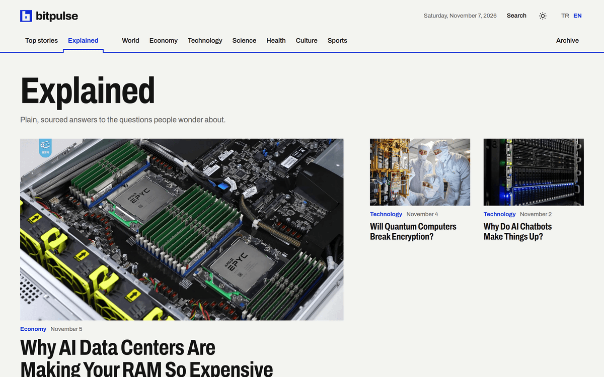
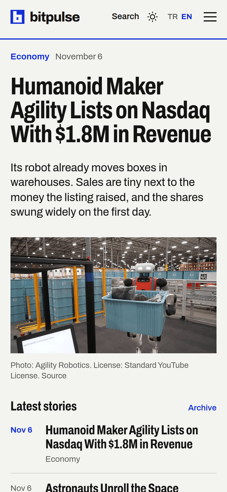
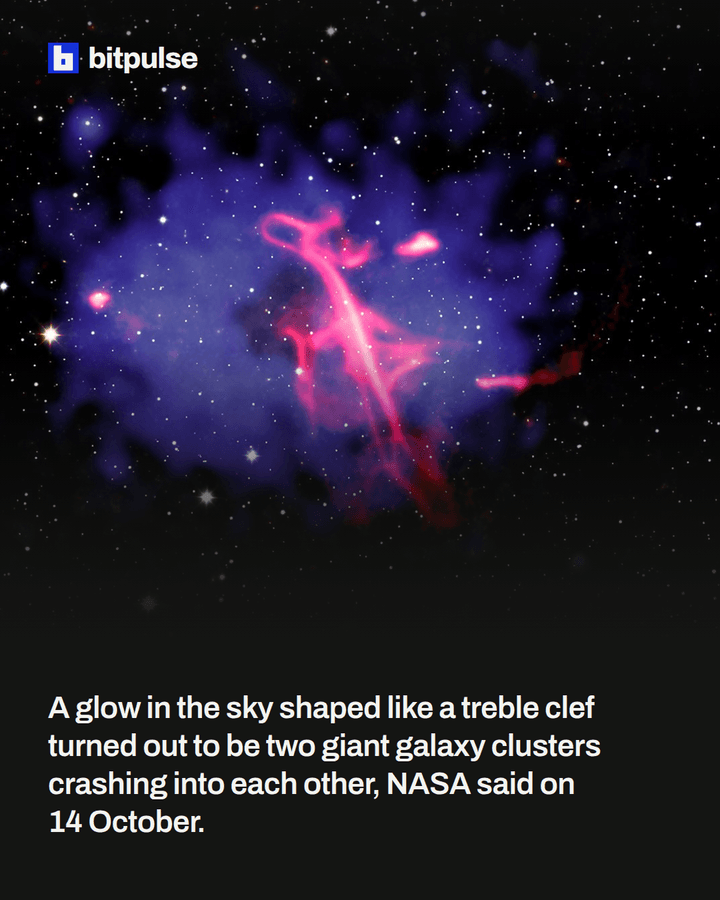

<div align="center">

<picture>
  <source media="(prefers-color-scheme: dark)" srcset="docs/readme/logo-dark.png">
  
</picture>

<p><strong>A news site that gathers stories from around the world.</strong></p>

<p>
<a href="https://bitpulse.cloud">bitpulse.cloud</a> ·
<a href="https://x.com/bitpulsecloud">X</a> ·
<a href="https://www.instagram.com/bitpulsecloud/">Instagram</a>
</p>

<p><a href="https://github.com/ayanburak/bitpulse.cloud/actions/workflows/ci.yml"></a></p>

<p><strong>English</strong> · <a href="README.tr.md">Türkçe</a></p>

</div>

<p align="center"></p>

## About

Bitpulse follows world events around the clock and publishes the stories worth sharing in seven categories: world, economy, technology, science, health, culture and sports. A news story is three to five hundred words long and says first what happened, then why it matters. Next to the news, the Explained section answers the questions people wonder about in longer pieces.

Stories are researched with the help of AI. Every fact is checked against the sources named under the story, and an editor reads each story before it goes live. The code, the stories and the editorial rules are public in this repository so that readers can see how the site works.

## Pages

<table>
<tr>
<td width="50%" valign="top">

<p><strong>Story</strong><br>
Headline, summary, publishing time in the reader's own time zone, and the sources at the end.</p>
</td>
<td width="50%" valign="top">

<p><strong>Explained</strong><br>
Longer pieces that answer one question each, with their own look.</p>
</td>
</tr>
<tr>
<td width="50%" valign="top" align="center">

<p align="left"><strong>Phone</strong><br>
The same pages on a small screen, with a light and a dark theme.</p>
</td>
<td width="50%" valign="top" align="center">

<p align="left"><strong>Social</strong><br>
Each news story is also shared on X and Instagram. The page and a still video of it are made from the story by a script.</p>
</td>
</tr>
</table>

## Structure

```
site/
  src/pages/             home, category, archive, story, search and policy pages
  src/components/        page layout and story blocks
  src/client/            the only script readers download
  src/stories.ts         the story rules the build enforces
  scripts/prerender.ts   writes every page as a finished HTML file
  scripts/new-story.ts   opens the folder of a new story
  scripts/social.ts      makes the X post, the Instagram page and its still video
  tests/                 unit tests, browser tests and sample stories
  deploy/                the content security policy and the code release script
api/                     stores stories in a database and queues every release
cli/                     the bitpulse command that drafts, publishes and copies stories
radar/                   listens to world news feeds and scores the events worth covering
reels/                   cuts reels for published stories
workflows/               the written workflows that take a candidate to a published story
docs/                    editorial policy, style guide, site decisions, architecture and security model
```

Published stories are not kept in this repository. They live in a database on the server, and every story keeps all its versions there. While a story is written it has its own folder, with en.md, tr.md, the image and social.yaml, so it can be read and reviewed in one place. The English and Turkish versions share their times, their category and their sources.

## Technical choices

### React only at build time

The pages are written by React during the build and served as plain HTML files. React never reaches the reader. The only script on a page is about 2 KB compressed and handles the theme, the search, the copy link button and the local times. A page is readable before any script runs, and a search engine sees the same page a reader does.

### The build refuses a broken story

A story that misses a language, a source, an image, an image license or a category stops the build. The English and Turkish versions must agree on their publishing time, their updates and their corrections. A mistake in a story is caught before release instead of by a reader.

### One time, shown in every time zone

Publishing, update and correction times are written in UTC. The page carries the UTC time, and the script turns it into the reader's own time zone. An update can bring a story back to the top of the home page with an Updated label. A correction never does, and it stays visible under the story.

### Social posts from one file

The X post and the Instagram page of a story are written once in its social.yaml. A script downloads the image, draws the page in a real browser and saves it also as a still vertical video, so the same post can go out as a reel. The tests check every text against the limits of X and Instagram, so a post that would be cut off is never published.

<details>
<summary><strong>Development</strong></summary>

<br>

Node.js 24 is used. The development server redraws pages on request, and the build writes the finished site into dist. A fresh checkout has no stories, so the variable below points the site at the sample stories used by the tests.

```bash
cd site
npm install
export BITPULSE_STORIES=tests/fixtures/stories
npm run dev
npm run build
npm run preview
```

A new story starts from its folder. The script names the folder with today's date, sets the publishing time to now, checks that the cover image is at least 1200 pixels wide and copies the sources from a research brief when one is given. Every field that still needs writing is left empty, so the build refuses the story until it is complete.

```bash
cd site
npm run new-story -- <key> <image-address> [brief.md]
npm run social -- <story-folder>
```

</details>

<details>
<summary><strong>Tests</strong></summary>

<br>

Unit tests check the story rules, the feed and the social posts. Browser tests run with Playwright against the built site. They follow every link, switch languages and themes, search, open the phone menu and read stories with JavaScript turned off.

```bash
cd site
npm test
npm run build
npx playwright install chromium
npm run test:e2e
```

GitHub Actions runs the type check, the unit tests, the build, the browser tests and a secret scan on every push.

</details>

<details>
<summary><strong>Releases</strong></summary>

<br>

A story is published with the bitpulse command, without Git or CI. The API stores it and queues one job, and a worker on the server builds a new release folder from the database. The worker makes it live by switching one link, so readers never see a half copied site. It checks the live pages afterwards and returns to the previous release when one of them fails. The last three releases are kept and a rollback only points the link back.

GitHub has no access to the server. Site code is released from the maintainer's machine, and only committed code can leave it. The whole system is described in [docs/architecture.md](docs/architecture.md) and the way it is protected in [docs/security.md](docs/security.md).

```bash
bash site/deploy/release-code.sh
```

</details>

## Editorial rules

How stories are chosen, sourced, written and corrected is described in [docs/editorial-policy.md](docs/editorial-policy.md). The voice and the headline rules are in [docs/style-guide.md](docs/style-guide.md), the social post format in [docs/social-posts.md](docs/social-posts.md), and the decisions behind the site in [docs/site-decisions.md](docs/site-decisions.md).

## Licenses

Three licenses apply because the project contains three kinds of work. Code and documents are released under the MIT License in [LICENSE](LICENSE), which keeps them easy to reuse. Stories are released under Creative Commons Attribution 4.0 as described in [LICENSE-CONTENT.md](LICENSE-CONTENT.md), because a reused story should still credit its source. Fonts keep their own SIL Open Font License, and those license files ship next to the fonts.

Story images and social images belong to their owners, who are named next to each image. They are not covered by the licenses of this repository.
