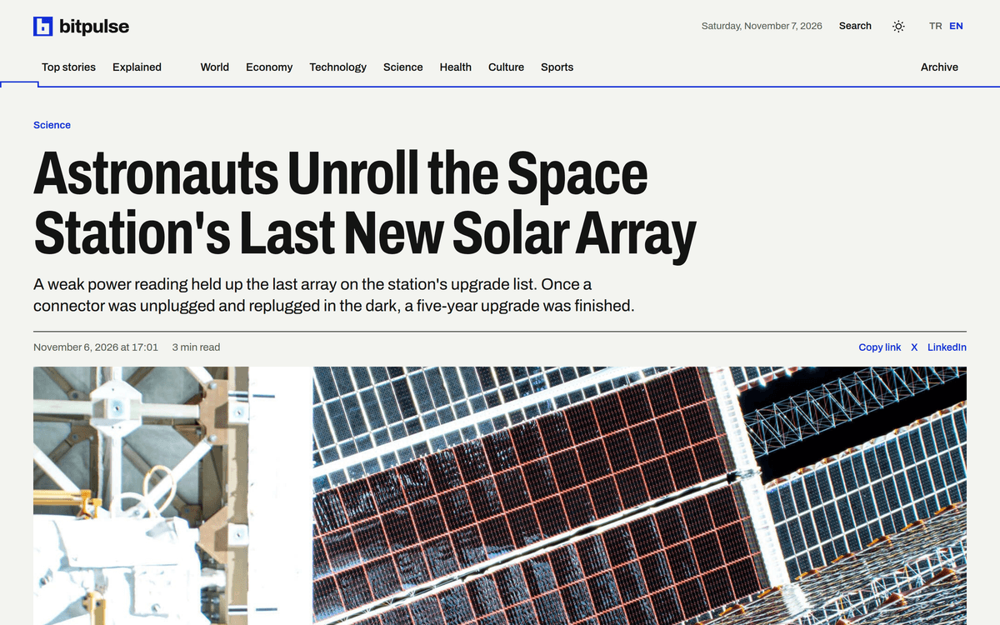
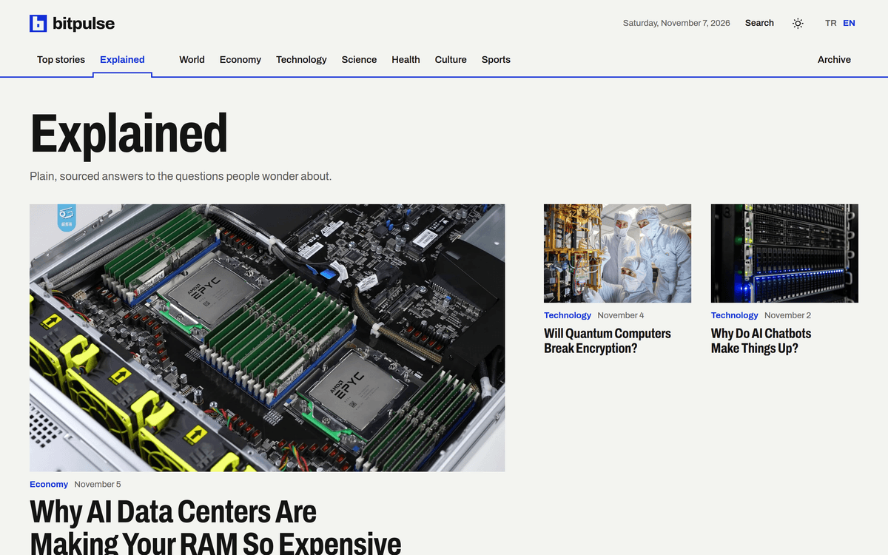
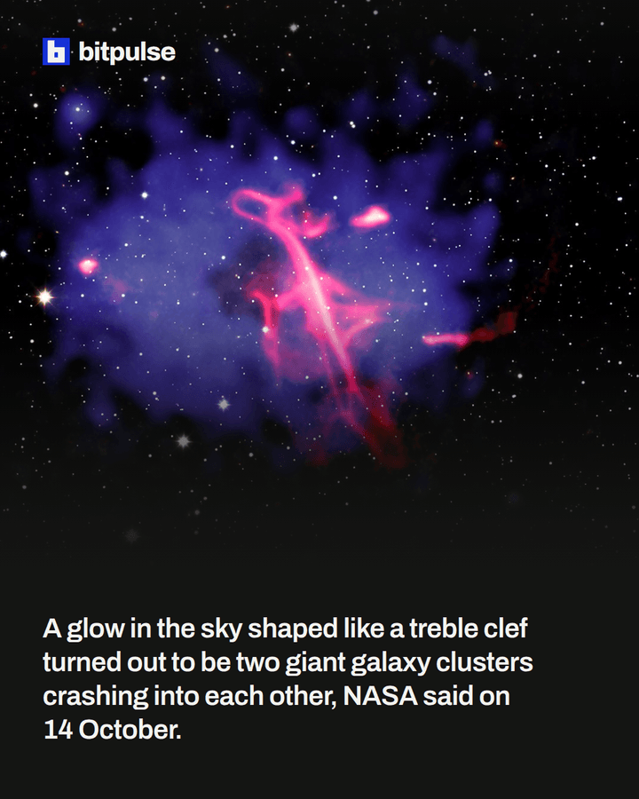

<div align="center">

<picture>
  <source media="(prefers-color-scheme: dark)" srcset="docs/readme/logo-dark.png">
  
</picture>

<p><strong>Dünyanın dört bir yanından haberleri bir araya getiren bir haber sitesi.</strong></p>

<p>
<a href="https://bitpulse.cloud">bitpulse.cloud</a> ·
<a href="https://x.com/bitpulsecloud">X</a> ·
<a href="https://www.instagram.com/bitpulsecloud/">Instagram</a>
</p>

<p><a href="https://github.com/ayanburak/bitpulse.cloud/actions/workflows/ci.yml"></a></p>

<p><a href="README.md">English</a> · <strong>Türkçe</strong></p>

</div>

<p align="center"></p>

## Hakkında

Bitpulse dünya gündemini gün boyu takip eder ve paylaşılmaya değer haberleri yedi kategoride yayınlar: dünya, ekonomi, teknoloji, bilim, sağlık, kültür ve spor. Bir haber üç yüz ile beş yüz kelime arasındadır ve önce ne olduğunu, sonra neden önemli olduğunu anlatır. Haberlerin yanında Merak bölümü, insanların merak ettiği soruları daha uzun yazılarla cevaplar.

Haberler yapay zekâ desteğiyle araştırılır. Her bilgi haberin altında adı geçen kaynaklarla karşılaştırılır ve her haberi yayından önce bir editör okur. Sitenin kodu ve yayın kuralları, okurlar sitenin nasıl işlediğini görebilsin diye bu depoda açıktır. Yayınlanan haberler sunucudaki veritabanında durur.

## Sayfalar

<table>
<tr>
<td width="50%" valign="top">

<p><strong>Haber</strong><br>
Başlık, özet, okurun kendi saat dilimindeki yayın saati ve sonda kaynaklar.</p>
</td>
<td width="50%" valign="top">

<p><strong>Merak</strong><br>
Her biri tek bir soruyu cevaplayan, kendi görünümü olan uzun yazılar.</p>
</td>
</tr>
<tr>
<td width="50%" valign="top" align="center">

<p align="left"><strong>Telefon</strong><br>
Aynı sayfalar küçük ekranda, açık ve koyu temayla.</p>
</td>
<td width="50%" valign="top" align="center">

<p align="left"><strong>Sosyal medya</strong><br>
Her haber X ve Instagram'da da paylaşılır. Sayfa ve onun hareketsiz videosu haberden bir script ile üretilir.</p>
</td>
</tr>
</table>

## Yapı

```
site/
  src/pages/             ana sayfa, kategori, arşiv, haber, arama ve ilke sayfaları
  src/components/        sayfa düzeni ve haber blokları
  src/client/            okurun indirdiği tek script
  src/stories.ts         build'in uyguladığı haber kuralları
  scripts/prerender.ts   her sayfayı hazır bir HTML dosyası olarak yazar
  scripts/new-story.ts   yeni bir haberin klasörünü açar
  scripts/social.ts      X metnini, Instagram sayfasını ve onun hareketsiz videosunu üretir
  tests/                 birim testleri, tarayıcı testleri ve örnek haberler
  deploy/                içerik güvenliği politikası ve kod yayını script'i
api/                     haberleri veritabanında tutar ve her yayını sıraya alır
cli/                     taslak yükleyen, yayınlayan ve haberleri kopyalayan bitpulse komutu
radar/                   dünya haber kaynaklarını dinler, ele alınmaya değer olayları puanlar
workflows/               adayı yayınlanmış habere götüren yazılı iş akışları
docs/                    yayın ilkeleri, üslup kılavuzu, site kararları, mimari ve güvenlik modeli
```

Yayınlanan haberler bu depoda tutulmaz. Sunucudaki bir veritabanında durur ve her haberin bütün sürümleri orada saklanır. Haber yazılırken en.md, tr.md, görsel ve social.yaml dosyalarıyla kendi klasörüne sahiptir, böylece tek bir yerden okunur ve incelenir. İngilizce ve Türkçe sürümlerin saatleri, kategorisi ve kaynakları ortaktır.

## Teknik tercihler

### React yalnızca build sırasında

Sayfalar build sırasında React ile yazılır ve düz HTML dosyaları olarak sunulur. React okura hiç ulaşmaz. Bir sayfadaki tek script sıkıştırılmış haliyle yaklaşık 2 KB'tır ve temayı, aramayı, bağlantı kopyalama düğmesini ve yerel saatleri yönetir. Sayfa hiçbir script çalışmadan okunabilir, arama motoru da okurun gördüğü sayfanın aynısını görür.

### Build eksik bir haberi reddeder

Dili, kaynağı, görseli, görsel lisansı ya da kategorisi eksik olan bir haber build'i durdurur. İngilizce ve Türkçe sürümlerin yayın saati, güncellemeleri ve düzeltmeleri aynı olmak zorundadır. Bir haberdeki hata okur fark etmeden önce, yayından önce yakalanır.

### Tek saat, her saat diliminde

Yayın, güncelleme ve düzeltme saatleri UTC olarak yazılır. Sayfa UTC saatini taşır, script bunu okurun kendi saat dilimine çevirir. Bir güncelleme haberi Güncellendi etiketiyle ana sayfanın en üstüne geri getirebilir. Düzeltme bunu hiçbir zaman yapmaz ve haberin altında görünür kalır.

### Sosyal paylaşımlar tek dosyadan

Bir haberin X metni ve Instagram sayfası bir kez, haberin social.yaml dosyasına yazılır. Bir script görseli indirir, sayfayı gerçek bir tarayıcıda çizer ve aynı paylaşım reels olarak da gidebilsin diye onu hareketsiz, dikey bir video olarak da kaydeder. Testler her metni X ve Instagram sınırlarına göre kontrol eder, böylece yarıda kesilecek bir paylaşım yayınlanmaz.

<details>
<summary><strong>Geliştirme</strong></summary>

<br>

Node.js 24 kullanılır. Geliştirme sunucusu sayfaları istek geldikçe yeniden çizer, build ise bitmiş siteyi dist klasörüne yazar. Yeni bir kopyada haber yoktur, bu yüzden aşağıdaki değişken siteyi testlerin kullandığı örnek haberlere yönlendirir.

```bash
cd site
npm install
export BITPULSE_STORIES=tests/fixtures/stories
npm run dev
npm run build
npm run preview
```

Yeni bir haber kendi klasörüyle başlar. Script klasöre bugünün tarihini verir, yayın saatini şimdi olarak yazar, kapak görselinin en az 1200 piksel genişliğinde olduğunu kontrol eder ve bir araştırma dosyası verildiyse kaynakları ondan alır. Yazılması gereken her alan boş bırakılır, böylece haber tamamlanana kadar build onu reddeder.

```bash
cd site
npm run new-story -- <anahtar> <görsel-adresi> [brief.md]
npm run social -- <haber-klasörü>
```

</details>

<details>
<summary><strong>Testler</strong></summary>

<br>

Birim testleri haber kurallarını, beslemeyi ve sosyal paylaşımları kontrol eder. Tarayıcı testleri Playwright ile build edilmiş site üzerinde çalışır. Her bağlantıyı izler, dili ve temayı değiştirir, arama yapar, telefon menüsünü açar ve haberleri JavaScript kapalıyken okur.

```bash
cd site
npm test
npm run build
npx playwright install chromium
npm run test:e2e
```

GitHub Actions her push'ta tür kontrolünü, birim testlerini, build'i, tarayıcı testlerini ve gizli bilgi taramasını çalıştırır.

</details>

<details>
<summary><strong>Yayın</strong></summary>

<br>

Bir haber bitpulse komutuyla, Git ve CI olmadan yayınlanır. API haberi kaydeder ve tek bir iş sıraya alır, sunucudaki işçi veritabanından yeni bir sürüm klasörü üretir. İşçi tek bir bağlantıyı değiştirerek sürümü yayına alır, böylece okur yarım kopyalanmış bir site görmez. Ardından canlı sayfaları kontrol eder ve biri hata verirse önceki sürüme döner. Son üç sürüm saklanır ve geri dönüş yalnızca bağlantıyı eski sürüme çevirir.

GitHub'ın sunucuya erişimi yoktur. Site kodu geliştiricinin cihazından yayınlanır ve yalnızca commit edilmiş kod çıkabilir.

```bash
bash site/deploy/release-code.sh
```

</details>

## Yayın kuralları

Haberlerin nasıl seçildiği, kaynaklandığı, yazıldığı ve düzeltildiği [docs/editorial-policy.md](docs/editorial-policy.md) dosyasında anlatılır. Ses ve başlık kuralları [docs/style-guide.md](docs/style-guide.md), sosyal paylaşım biçimi [docs/social-posts.md](docs/social-posts.md), sitenin arkasındaki kararlar [docs/site-decisions.md](docs/site-decisions.md) dosyasındadır. Bu belgeler İngilizcedir.

## Lisanslar

Proje üç tür iş içerdiği için üç lisans geçerlidir. Kod ve belgeler [LICENSE](LICENSE) dosyasındaki MIT Lisansı ile yayınlanır, bu onları yeniden kullanmayı kolay tutar. Haberler [LICENSE-CONTENT.md](LICENSE-CONTENT.md) dosyasında anlatıldığı gibi Creative Commons Atıf 4.0 ile yayınlanır, çünkü yeniden kullanılan bir haber kaynağını yine de göstermelidir. Fontlar kendi SIL Open Font License lisanslarını korur ve lisans dosyaları fontların yanında durur.

Haber görselleri ve sosyal medya görselleri, her görselin yanında adı yazan sahiplerine aittir. Bu deponun lisanslarının kapsamında değildir.
